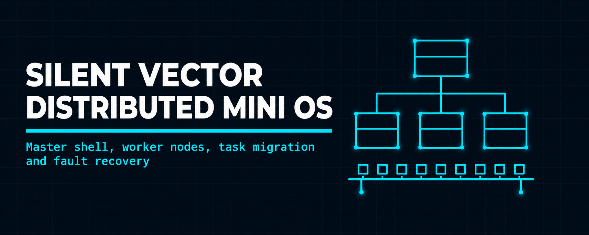
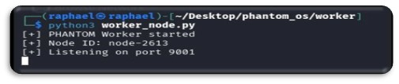
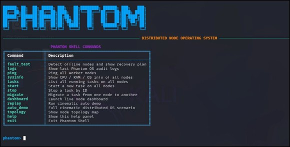
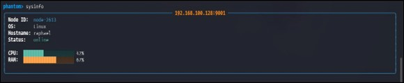
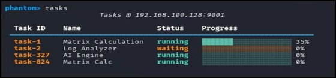
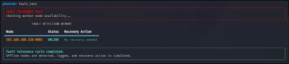
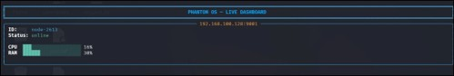
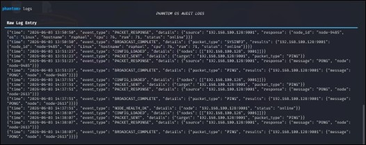

<p align="center">
  
</p>

<h1 align="center">Silent Vector</h1>

<h3 align="center">Distributed mini operating system in Python, powered by Phantom OS</h3>

<p align="center">
  
  
  
  
  
</p>

<p align="center">
  <a href="#overview"><b>Overview</b></a> ·
  <a href="#features"><b>Features</b></a> ·
  <a href="#commands"><b>Commands</b></a> ·
  <a href="#screenshots"><b>Screenshots</b></a> ·
  <a href="#build--run"><b>Run</b></a> ·
  <a href="#repository-structure"><b>Structure</b></a> ·
  <a href="#license"><b>License</b></a>
</p>

---

## Overview

Silent Vector is a Python-based distributed mini operating system simulation. A master shell, the Phantom Shell, controls one or more worker nodes over TCP sockets. It was built to demonstrate node communication, task orchestration and fault resilience in an interactive terminal environment.

The name reflects the design: the master node silently monitors every worker, collecting telemetry, tracking tasks and detecting failures, without interrupting operations.

| | |
| --- | --- |
| **Language** | Python 3 |
| **Architecture** | Master-worker over TCP sockets |
| **Interface** | Phantom Shell, a styled terminal UI with 14 commands |
| **Protocol** | Custom packet layer with JSON payloads and checksum validation |
| **Configuration** | Node list in `shared/config.json` |
| **Logging** | Structured JSON audit log |
| **License** | MIT |
| **Purpose** | Educational project on distributed systems concepts |

## Features

| Feature | Description |
| ------- | ----------- |
| Node communication | Worker nodes register with a unique Node ID and answer packets from the master |
| Real-time monitoring | Live ASCII dashboard showing CPU and RAM usage per node |
| Task management | Start, stop and list tasks with progress tracking |
| Task migration | Move a task from one node to another |
| Fault tolerance | Detects offline nodes, logs them and simulates a recovery action |
| Topology view | ASCII tree of the master and its worker nodes, loaded from config |
| Audit logging | Every event written to `shared/phantom.log` as JSON |
| Demo modes | `auto_demo` and `replay` run a scripted walkthrough |

## Commands

| Command | Description |
| ------- | ----------- |
| `ping` | Ping all registered worker nodes and show response status |
| `sysinfo` | Query CPU, RAM, OS and hostname from all nodes |
| `tasks` | List running and waiting tasks on all nodes |
| `start` | Start a new task on the connected nodes |
| `stop` | Stop a running task by Task ID |
| `migrate` | Migrate a task from one node to another |
| `dashboard` | Launch the live ASCII monitoring dashboard |
| `logs` | Show the last entries of the audit log |
| `replay` | Run the scripted replay demo |
| `auto_demo` | Run the five-step automated distributed OS scenario |
| `topology` | Show the network topology map |
| `fault_test` | Detect offline nodes and simulate recovery |
| `help` | Show the command panel |
| `exit` | Exit the shell |

## Communication Protocol

All traffic between nodes goes through the packet layer in `protocol/packet.py`. Each packet carries:

| Field | Purpose |
| ----- | ------- |
| Source and destination | Node identifiers |
| Packet type | `PING`, `SYSINFO`, `TASK_START`, `TASK_STOP`, `MIGRATE` and others |
| Payload | Data serialised as JSON |
| Checksum | Integrity validation |

## Screenshots

Captured while the system was running. The full walkthrough is in the [project report](./docs/SilentVector.pdf).

| | |
| --- | --- |
|  |  |
| <sub>Worker node registering as node-2613 on port 9001</sub> | <sub>Phantom Shell with all 14 commands</sub> |
|  |  |
| <sub>`sysinfo`: node ID, OS, hostname, CPU and RAM</sub> | <sub>`tasks`: running and waiting tasks with progress</sub> |
|  |  |
| <sub>`topology`: master node and worker status</sub> | <sub>`fault_test`: offline node detected, tasks marked for reassignment</sub> |
|  |  |
| <sub>`dashboard`: live CPU and RAM bars</sub> | <sub>`auto_demo`: ping to task migration in five steps</sub> |

## Tech Stack

| Component | Technology |
| --------- | ---------- |
| Programming | Python 3 |
| Networking | TCP sockets |
| Message format | JSON with a custom packet layer |
| Terminal UI | ASCII dashboard and styled shell |
| Logging | JSON audit log |

## Build & Run

Python 3 is required on every machine, and the master must be able to reach the workers over the network.

Clone the repository:

```bash
git clone https://github.com/abdul-wahid022/silent-vector-distributed-mini-os.git
cd silent-vector-distributed-mini-os
```

1. Start one or more worker nodes, each on its own terminal or machine:

```bash
python3 worker/worker_node.py <port>
```

2. List the workers in `shared/config.json`:

```json
{ "nodes": [["192.168.100.128", 9001]], "topology": [] }
```

3. Launch the Phantom Shell on the controller machine:

```bash
python3 master/phantom_shell.py
```

## Repository Structure

```
silent-vector-distributed-mini-os/
├── README.md
├── LICENSE
├── images/
│   ├── banner.png
│   ├── worker-startup.png
│   ├── phantom-shell.png
│   ├── sysinfo.png
│   ├── tasks.png
│   ├── topology.png
│   ├── fault-test-offline.png
│   ├── live-dashboard.png
│   └── auto-demo.png
├── docs/
│   └── SilentVector.pdf
├── master/
│   ├── phantom_shell.py
│   ├── node_manager.py
│   └── dashboard.py
├── worker/
│   └── worker_node.py
├── protocol/
│   └── packet.py
├── shared/
│   ├── config.json
│   └── replay_demo.json
└── sandbox/
    └── demo_file.txt
```

## License

**© 2026 Abdul Wahid**. Released under the [**MIT License**](./LICENSE). You may use, copy, modify and distribute this code, including commercially, as long as the copyright notice and license text are kept with it. The software is provided as is, without warranty.

## Contact

<p align="center">
  <b>Abdul Wahid</b>
</p>

<p align="center">
  <a href="mailto:a.wahid7860668@gmail.com"></a>
  <a href="https://www.linkedin.com/in/abdul-wahid022"></a>
  <a href="https://github.com/abdul-wahid022"></a>
</p>
